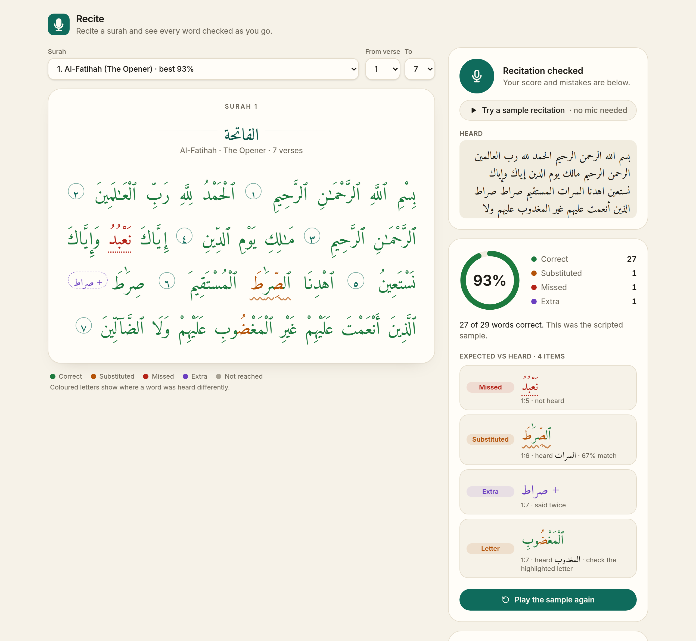
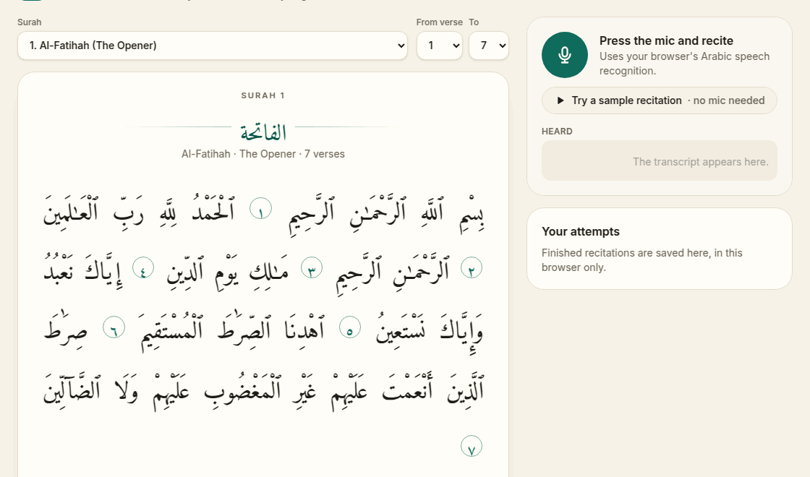
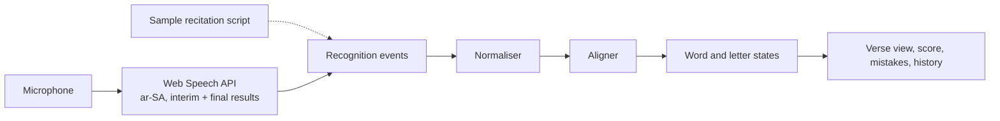
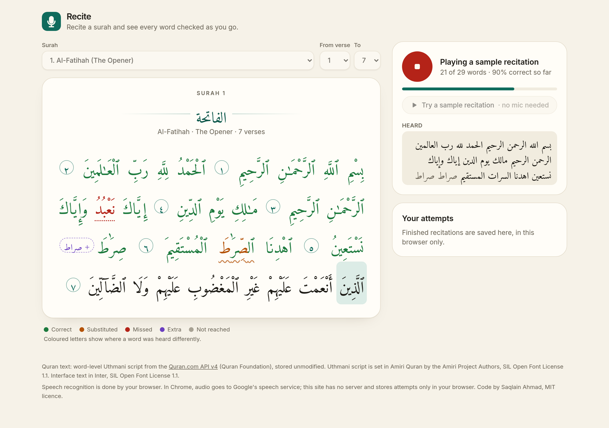
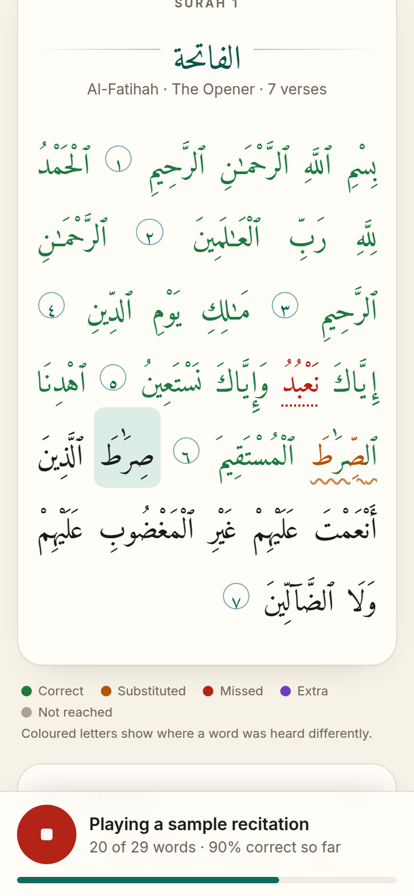

# Recite

A browser Quran recitation coach: recite a surah into the mic and every word is marked correct, substituted, missed or extra as you go, down to the letter.



Live demo: _coming soon_

## How it works

Press the mic and recite. Chrome's speech recognition (`ar-SA`) streams a transcript back while you speak. Each word of that transcript is normalised, aligned against the Uthmani text of the surah, and the verse view colours the matching word as soon as it is heard. When you stop, the app scores the attempt, lists every mistake as expected vs heard, and saves it to the attempt history in your browser.

No microphone? **Try a sample recitation** plays a scripted transcript of the surah through the same pipeline, word by word, with a few deliberate mistakes in it. On Al-Fatiha those are a substituted word, a skipped word, a repeated word and a one-letter slip.





| While reciting | On a phone (390 px) |
| --- | --- |
|  |  |

The engine is kept apart from the UI:

- `src/engine/` is plain TypeScript with no React: normalisation, edit distance, word scoring, the streaming matcher, letter grouping, the disconnected letters (muqatta'at) and the score summary.
- `src/speech/` turns the Web Speech API, or the sample script, into one stream of interim and final results.
- `src/hooks/` holds the state: `useRecognizer` (speech source lifecycle), `useAlignment` (engine state), `useRecitation` (one attempt from start to score), `useSurah` (bundled text or the quran.com API) and `useHistory`.
- `src/components/` renders it: the verse view, the controls, the result panel and the history.

## The interesting problems

### Arabic normalisation: the mushaf is not spelled like the transcript

The verses are shown in the Uthmani script of the mushaf, but a recogniser writes modern standard spelling without vowel marks. The same word can differ in ways that are not mistakes:

| Uthmani text | Recogniser writes | Why they differ |
| --- | --- | --- |
| مَـٰلِكِ | مالك | dagger alef written as a full alef |
| ٱلرَّحْمَـٰنِ | الرحمن | dagger alef not written at all |
| إِنَّهُۥ | إنه | small waw dropped |
| يَـٰٓأَيُّهَا | يا أيها | one mushaf word, two standard words |
| وَءَامَنَهُم | وآمنهم | standalone hamza and alef, written as one alef with madda |

The Arabic in this table is copied from the bundled data: the Uthmani column is the API's `text_uthmani`, the other column its `text_imlaei` with the vowel marks removed.

The normaliser therefore turns each expected word into units, where each unit lists the letters it accepts and whether it is optional. The dagger alef, small waw and small yeh, and a standalone hamza become optional units; alef forms (أ إ آ ٱ), ta marbuta and ha, alef maksura and ya, and the hamza carriers fold together; tatweel and the Quranic annotation marks are dropped. A weighted Levenshtein distance then skips an optional unit for free and matches it when it is there.

A test checks every one of the 230 bundled words against the API's own standard spelling of that word, and all of them score an exact match.

### Alignment: following a reciter who skips, repeats and stumbles

The matcher reads the transcript one word at a time and looks for that word in a window of the next eight expected words, with a small bonus for the word at the cursor. Scores at or above 0.70 are correct, 0.55 to 0.70 substituted, and if nothing in the window is close it searches further ahead for a near-exact match (0.85), which handles a skipped verse. On top of that:

- **Gaps are aligned.** When the reciter jumps ahead, the skipped words and the unmatched words heard in between are lined up with a small Needleman-Wunsch alignment, so "said X instead of Y" is reported as one substitution instead of a miss plus an extra word.
- **Repeats stay repeats.** Saying the last word again, which reciters do all the time, is recorded as a repeat instead of jumping to the next copy of that word further on.
- **Split words are merged.** Up to three spoken words are tried together when standard spelling splits a mushaf word.
- **Openings are expected.** The Bismillah is accepted before every surah that has it and never counted as missed; the ta'awwudh is recognised and dropped.
- **Disconnected letters.** Recognisers spell الٓمٓ out as "alif lam mim" or garble it into the next word; those spellings are rewritten into the letters before matching.

### Letter-level highlighting inside joined script

To show which letter was wrong, each expected word is split into letter groups (a base letter with the marks drawn on it), the units of the word are aligned with the letters that were heard, and each group takes the worst status of its letters: missing beats wrong beats right. Optional letters that were left out are not flagged.

Colouring one letter means splitting a cursive word into separate spans, and a browser that shapes each span on its own breaks the joins between letters. Chrome and Firefox shape across spans; other engines may not. The app measures this once at start-up (four joined letters against the same letters in four spans) and, only if the widths differ, inserts a zero-width joiner on both sides of each split where the two letters connect.

### Streaming partial results

Chrome sends interim results that it keeps revising, and each result becomes final exactly once. The engine is a set of pure functions, so the hook keeps a committed state built only from final results; every interim result is matched on top of that committed state into a preview and thrown away when the next one arrives, so a revised guess never reaches the score. The speech source also restarts recognition when Chrome ends a session after a pause, guards against Android builds that repeat the whole transcript in every final result, and counts the last interim words when you press stop.

## Tests

```bash
npm test
```

135 tests in 15 files (Vitest). They cover the engine, the data layer and the state logic behind the hooks:

- normalisation: harakat, shadda, sukun and tanween; alef, hamza, ta marbuta and alef maksura variants; tatweel; Quranic annotation marks; optional dagger alef, small waw, small yeh and hamza; every bundled word against its standard spelling
- edit distance and the alignment operations behind letter colouring, including tie-breaking
- word scoring, the matcher thresholds and each special case
- letter grouping with diacritics, worst status per group, and joiners that never change the visible text
- muqatta'at: letters spelled by name, the short forms, garbled and glued words, and a full match of the opening of al-Baqarah
- the matcher: substitution vs miss vs extra, gap alignment, repeats, split words, the Bismillah, the ta'awwudh, words never reached, and streaming segment by segment giving the same result as one transcript
- the sample recitation: for all eleven bundled surahs, the engine finds exactly the mistakes the script planted
- the alignment state: interim results previewed but never committed, final results committed once, and the last interim words counted on stop
- the quran.com API client (pagination, verse-number markers, caching, errors), attempt history storage, and the integrity of the bundled text

## Quick start

Requires Node 22.

```bash
npm ci
npm run dev          # http://localhost:5173
npm test
npm run typecheck
npm run build        # static files in dist/
```

For GitHub Pages, build with the repository path as the base: `BASE_PATH=/recite/ npm run build`. The workflow in `.github/workflows/deploy.yml` does this on every push to `main`.

Other scripts:

- `npm run fetch:quran` downloads the bundled text again from the quran.com API.
- `npm run screenshots` and `npm run demo-gif` regenerate the images in `docs/screenshots/` from a production build. They need puppeteer; set `PUPPETEER_MODULE` to the path of an existing install if it is not installed here.

## Browser support

- **Live recitation** needs the Web Speech API with Arabic. It works in Chrome and Edge on desktop and Android. Safari has the API but is untested. Firefox does not have it; the app says so and keeps the sample recitation available.
- **Everything else** (the verse view, the sample recitation, history) works in any current browser.
- The microphone needs HTTPS or `localhost`.

## Limitations

- It checks words, not pronunciation or tajweed. A speech-to-text engine writes standard spelling, so it can "correct" a mispronounced word into the right one, and it can mishear a correct recitation. The thresholds are set to tolerate that noise, and the letter colours show where the transcript differs from the text, not how a letter was articulated.
- In Chrome the audio is sent to Google's speech service, so live recitation needs a network connection. This app has no server and keeps attempts only in your browser.
- Because hamza and the long vowels written as small letters are optional in matching, leaving them out is never flagged.
- The matcher looks at most 300 words ahead, and the sample recitation covers at most about 60 words; on a long surah, pick a verse range.
- Only Al-Fatiha and surahs 105 to 114 are bundled and work offline. Other surahs come from the public quran.com API, which needs no key today but could change.

## Credits

- **Quran text:** the [Quran.com API v4](https://api.quran.com/api/v4) by Quran Foundation. The bundled files hold the word-level `text_uthmani` and `text_imlaei` fields, copied byte for byte by `scripts/fetch-quran.mjs` (fetched 2026-10-25); other surahs are fetched from the same API in the browser.
- **Fonts:** [Amiri Quran](https://github.com/aliftype/amiri) by the Amiri Project Authors and [Inter](https://github.com/rsms/inter) by the Inter Project Authors, both under the SIL Open Font License 1.1, bundled through Fontsource.

## Licence

The code is released under the [MIT licence](LICENSE), © 2026 Saqlain Ahmad. The Quran text and the fonts are not covered by it and keep their own licences and terms; see [NOTICE](NOTICE).
